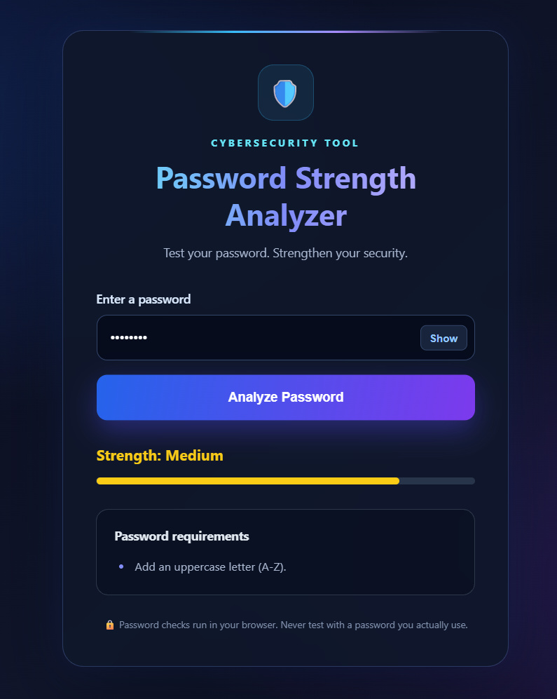

# 🔐 Password Strength Analyzer

A simple web-based cybersecurity project that evaluates password strength and provides suggestions to create stronger, more secure passwords.

## 📸 Application Preview



## ✨ Features

- Checks password strength.
- Classifies passwords as Weak, Medium, or Strong.
- Provides suggestions to improve password security.
- Includes a show/hide password option.
- Simple and user-friendly interface.

## 🛠️ Technologies Used

- Python
- Flask
- HTML
- CSS
- JavaScript

## 📂 Project Structure

```text
Password-Strength-Analyzer/
├── app.py
├── requirements.txt
├── README.md
├── screenshot.png
├── templates/
│   └── index.html
└── static/
    ├── style.css
    └── script.js
```

## ⚙️ Installation and Setup

1. Clone the repository:

```bash
git clone https://github.com/anchalkanthi-source/Password-Strength-Analyzer.git
```

2. Navigate to the project folder:

```bash
cd Password-Strength-Analyzer
```

3. Create and activate a virtual environment:

```bash
python -m venv venv
```

Windows PowerShell:

```powershell
.\venv\Scripts\Activate.ps1
```

4. Install the required packages:

```bash
pip install -r requirements.txt
```

5. Run the application:

```bash
python app.py
```

6. Open your browser and visit:

```text
http://127.0.0.1:5000
```

## 🚀 Future Improvements

- Add more advanced password security checks.
- Improve password analysis using additional security rules.
- Enhance the user interface.

## 👩‍💻 Author

**Anchal Kanthi**

GitHub: [anchalkanthi-source](https://github.com/anchalkanthi-source)